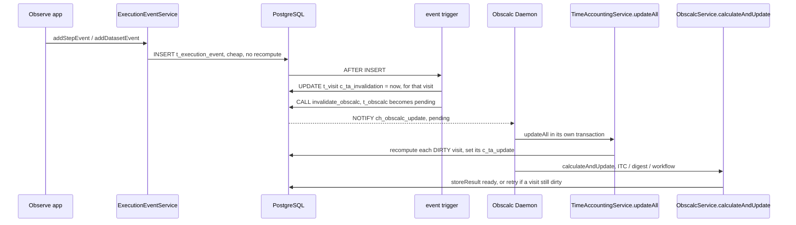

# Time Accounting Flow

## Overview

Time accounting is the record of how much observing time an execution consumed
and how it was charged. It is computed **per visit** and stored on `t_visit`
(`c_raw_*` and `c_final_*` interval columns), plus a set of discount rows in
`t_time_charge_discount`. It is *derived* data: a function of the visit's
execution events, its datasets' QA state, manual staff corrections, and the
observing night.

It is recomputed **asynchronously by the obscalc worker** rather than inline
when events arrive. An execution event only marks the affected visit dirty; the
worker picks the observation up and recomputes the dirty visits. This keeps the
event-ingestion path (from the "Observe" application) cheap.

The rules themselves are **versioned**. Each visit records the version of the
rules that produced its charge, and the code only implements the current one, so
a visit left on an older version is **frozen**: never recomputed, whatever
happens to it. A change to the rules decides once, when it ships, which visits
move to the new rules. See [Rule versions and frozen visits](#rule-versions-and-frozen-visits).

See [`obscalc-flow.md`](obscalc-flow.md) for the worker/daemon
machinery this rides on.

## Where it lives

| Concern | Location |
|---|---|
| Compute a visit's invoice, write `t_visit` + discounts | `TimeAccountingService.update(visitId)` (`Update.run`) |
| Recompute all *dirty* visits of an observation | `TimeAccountingService.updateAll(observationId)` |
| Manual staff correction | `TimeAccountingService.addCorrection(visitId, …)` (synchronous) |
| Unfreeze (move to the current rules and recompute) | `unfreezeTimeAccounting` mutation → `TimeAccountingService.unfreezeObservation` / `unfreezeVisit` (synchronous) |
| Record an execution event (marks a visit dirty) | `ExecutionEventService` insert methods |
| Drive the recompute in the worker | obscalc daemon `Main.scala` `calcAndUpdateStream` |
| Re-mark visitor-instrument visits whose charge end moved | `TimeAccountingService.invalidateStaleVisitorVisits`, obscalc `visitorTimeAccountingStream` |
| Retry decision when a recompute fails | `ObscalcService.storeResult` |
| Current rules version | `TimeAccounting.version.Current` (Scala) |
| Triggers, markers, procedures | migrations `V1210__async_time_accounting.sql`; `V1420__visit_time_accounting_version.sql` (versions, lock rule, upgrade procedure); `V1421__dataset_qa_passes.sql` (what counts as passing QA) |
| Startup check that code and database agree on the version | `StartupDiagnostics.checkTimeAccountingVersion` (ODB service and obscalc) |

## What causes time accounting to update

In normal operation **two things change a visit's charge**, and each is scoped to
a single visit:

1. **An execution event** is recorded for the visit (`t_execution_event`, which
   has `c_visit_id NOT NULL`).
2. **A dataset starts or stops passing QA** (`t_dataset`, also
   `c_visit_id NOT NULL`) — this adds or removes a QA discount for the visit
   that contains the dataset. "Passing" is decided in one place, the
   `dataset_qa_passes` SQL function: an unassessed (null) or `pass` state
   passes, anything else, including states added later, doesn't. It mirrors
   `isPassing`/`orPassing` in the sequence module.

Both go through `invalidate_visit_time_accounting(visit_id, observation_id)`,
which:

- `UPDATE t_visit SET c_ta_invalidation = now()` for **that visit only**, and
- `CALL invalidate_obscalc(observation_id)` so the worker picks the observation
  up (and the obscalc digest/workflow refresh too).

Three more paths exist:

- **The visitor sweep.** A visitor-instrument visit is charged until the next
  chargeable visit at the site starts or, once the night is over, until dawn, so
  its charge can change without anything happening to the visit itself. The
  obscalc worker periodically re-marks recent visitor visits whose charge would
  now end differently (`invalidateStaleVisitorVisits`), through the same
  procedure.
- **A change to the rules.** The migration that introduces a new rules version
  marks the visits it moves to it dirty (see
  [Rule versions and frozen visits](#rule-versions-and-frozen-visits)).
- **Staff actions.** Manual corrections are handled **synchronously** in
  `addCorrection` (staff, rare) and do **not** go through this path — they write
  the correction row and adjust `t_visit` immediately, even on a frozen visit.
  `unfreezeTimeAccounting` recomputes synchronously too.

A visit that is **frozen** (on an older rules version) still gets marked dirty
by these paths, but the recompute leaves it alone.

## The per-visit dirty markers

`t_visit` carries two timestamps:

| Column | Meaning |
|---|---|
| `c_ta_invalidation` | Bumped to `now()` when this visit is invalidated (event / QA change). |
| `c_ta_update` | Set to the invalidation value that was just recomputed. |

A visit is **dirty** iff `c_ta_invalidation > c_ta_update`.
`updateAll(observationId)` selects only the observation's dirty visits, in visit
id order, recomputes each with `update(visitId)`, and sets that visit's
`c_ta_update` to the invalidation timestamp it observed.

`updateAll` only selects visits on the current rules version **or older**. A
frozen visit (older) is selected and marked updated, but `Update.run` leaves its
stored charge alone. A visit on a **newer** version than the code (only possible
after a rollback) is left dirty on purpose, so that the newer code recomputes it
when it returns; `storeResult` doesn't count such visits as a failed recompute
either.

Existing visits (at migration time) get equal default timestamps → not dirty →
never recomputed until a genuine change occurs.

## Why NOT recompute otherwise-unchanged visits

This is the central design invariant, and it is deliberate.

Time accounting is derived, but its stored values are also **acted on by
humans**: staff review the automated numbers and enter manual corrections, and a
program's charged time is a real accounting figure. Consider:

1. Visit V1 executes early in the semester; its charge is computed and staff add
   manual correction entries after reviewing it.
2. Months pass. The time-accounting **algorithm is changed** in a deploy.
3. A new visit V2 of the *same observation* begins executing.

If recomputing were scoped to the *observation* (recompute-all-visits), every
event in V2 would re-derive V1 as well — under the **new** algorithm. The
correction rows survive (they're reapplied from `t_time_charge_correction`), but
the base they sit on drifts, so V1's stored final charge silently changes away
from the value staff reviewed and approved. That is worse than losing the
corrections outright: it looks authoritative but no longer matches the human
decision.

Two mechanisms prevent this:

1. **Per-visit scoping.** Recompute only the **visit that actually changed**:
   V2's events touch only V2; V1 is recomputed only if *it* receives an event or
   a QA change.
2. **Rule versions.** Even V1's own changes can't silently re-price it under a
   new algorithm once it is settled: if V1 was locked when the algorithm changed,
   it stayed on the old version and is now frozen. A late QA change on V1 is then
   ignored; staff adjust it with a correction or explicitly unfreeze it (see
   [Rule versions and frozen visits](#rule-versions-and-frozen-visits)).

Two corollaries fall out of per-visit scoping:

- **Unrelated obscalc invalidations don't touch time accounting.** A target/mode
  edit, or a migration that blanket-sets observations to `pending`, invalidates
  obscalc but marks no visit dirty, so `updateAll` is a no-op. (This is why the
  markers are on `t_visit`, not `t_obscalc`.)
- **QA changes reach old, closed visits** that aren't frozen, because the QA
  trigger marks *that* visit dirty. A frozen visit's charge doesn't follow QA
  changes; `TimeChargeInvoice.frozen` says which visits those are.

## Rule versions and frozen visits

### Versions

Each change to the time accounting rules gets a new **version**:

| Where | What |
|---|---|
| `t_time_accounting_version` | One row per version (`c_version`, `c_description`). The latest is the one the service implements. |
| `TimeAccounting.version.Current` | The version the code implements. A startup check requires it to match the table (see [Deploys and rollbacks](#deploys-and-rollbacks)). |
| `t_visit.c_ta_version` | The version that produced the visit's stored charge. Defaults to `current_time_accounting_version()`, the latest row, so new visits get the current rules. |
| `TimeChargeInvoice.rulesVersion` / `.frozen` | The same, exposed in GraphQL; `frozen` is true when the visit's version isn't `Current`. |

The code implements **only** the current rules and never branches on a visit's
version. `Update.run` recomputes a visit only when its version equals `Current`;
any other visit keeps its stored charge.

| Version | Rules |
|---|---|
| 1 | The rules before versions were recorded. |
| 2 | A visit in which no written science dataset passes QA is not charged at all (see [What a recompute actually computes](#what-a-recompute-actually-computes)). |

### Frozen vs. locked

These are easy to confuse:

- **Frozen**: the visit is on a version other than `Current`. Nothing recomputes
  it; later events and QA changes don't affect its charge. This is what
  `TimeChargeInvoice.frozen` reports.
- **Locked**: `visit_time_accounting_locked(visit, as_of)` is true when
  - staff have corrected its charge (recomputing under different rules could
    count the correction twice), or
  - its observing night is over and none of its *written science* datasets is
    awaiting QA (acquisition datasets and never-written ones aren't expected to
    be assessed, as in `v_observation_qa`), or
  - a week has passed since its observing night ended.

  The night's end comes from `observing_night_end(site, t)`, which mirrors
  lucuma-core's `ObservingNight` (14:00 local at the site; a test compares them).

Being locked **changes nothing on its own**. It matters only at the moment a new
version is added, when it decides which visits stay behind and become frozen.
Until then a locked visit on the current version keeps following its changes.
For example:

1. A visit is observed tonight on version 2: not locked, not frozen.
2. Its datasets are assessed the next day: locked, but not frozen, so the QA
   changes apply.
3. Version 3 ships months later: the visit is locked, so it stays on version 2
   and is now frozen.
4. A later QA change is ignored; `frozen` says so.

### Adding a version

1. Change the rules in the code. Don't branch on the visit's version: older
   visits are simply frozen.
2. Increment `TimeAccounting.version.Current`.
3. In the accompanying migration, call
   `add_time_accounting_version(<new version>, '<description>')`.

The code and the migration must ship together; the startup check refuses to run
a service whose version is ahead of the database.

`add_time_accounting_version(version, description)`:

1. Raises unless `version` is the current one + 1 (versions are explicit
   numbers, not a serial, so that the migration and the Scala constant visibly
   agree and a version can't be skipped or reused).
2. Inserts the row, which makes it the column default for new visits.
3. Moves every visit that **wasn't frozen when the upgrade started** (it is on
   the version being replaced, `version - 1`) and is **either awaiting a
   recompute or not locked**, marking it dirty. Visits frozen on older versions
   stay frozen. A locked visit that is awaiting a recompute (say a QA change the
   worker hasn't reached yet) moves too, since the code for the old rules is
   gone and leaving it behind would silently drop that change.
4. Invalidates obscalc for the moved visits' observations, so the worker
   recomputes them under the new rules.

It updates `t_visit` before invalidating obscalc and takes no execution locks,
the reverse of the [usual order](#order). That is safe only because migrations
run as the ODB service starts, before it accepts requests, while obscalc waits
for them; run against a live database it could deadlock, and rerunning is the
remedy.

### Unfreezing

Staff can move a visit, or every visit of an observation, to the current rules
with the `unfreezeTimeAccounting` mutation (`observationId`,
`observationReference` or `visitId`). Unlike the worker it recomputes
**synchronously**:

1. Takes the observation's execution lock and invalidates obscalc (the
   [usual order](#order)).
2. Moves the targeted visits to `Current`, locking them in visit id order and
   bumping their invalidation.
3. Recomputes each and records the invalidation it set, as `updateAll` does, so
   the worker doesn't redo them.

Corrections are reapplied to the recomputed charge, so a correction that
compensated for the old rules may need revisiting. A visit that isn't frozen is
simply recomputed. A visit on a newer version than the code is left alone. The
result's `visits` lists the visits actually moved and recomputed, so a caller
can see when something was skipped.

### Deploys and rollbacks

- **Migrations run in the ODB service** (Flyway, at startup). **obscalc waits**
  for them before its startup diagnostics: it polls Flyway's pending migrations
  every 5 seconds, beating its worker heartbeat each time, retries a check that
  fails, and gives up (crashing the dyno visibly) after 15 minutes.
  `--skip-migration-wait` skips the wait, e.g. against a local database without
  SSL.
- **The startup check** (`checkTimeAccountingVersion`, in both services): a
  database *behind* the code, or an empty version table, is fatal. A database
  *ahead* of the code (after a rollback past a rules change) only logs a
  warning: the code leaves visits on the newer version alone (dirty, never
  unfrozen), so it is safe to run, just not complete. New visits created during
  such a rollback get the newer version by default and wait for the newer code.
- **The release that introduced versions** had a narrow window in which an old,
  pre-version obscalc worker, still shutting down, could have recomputed a visit
  the migration had just moved to version 2 under the version-1 rules. The two
  versions only differ for visits whose science datasets all failed QA, and
  later releases are protected by the version filter above.

## Flow



Key point: `updateAll` runs in **its own transaction, before and independent of**
`calculateAndUpdate`. Time accounting is pure DB work; the ITC/digest calculation
can hit a remote service and fail. Keeping them separate means an ITC failure can
never stall or revert a time-accounting recompute.

## Interaction subtleties

### Retry when a recompute fails

`updateAll` is best-effort in the daemon (errors are logged and swallowed). If it
fails, the visit stays dirty (`c_ta_update` was never advanced). To avoid
orphaning that dirty state, `storeResult` checks whether **any** visit of the
observation is still dirty when the obscalc calculation finishes, and if so sets
the entry to `retry` (with the normal exponential backoff) instead of `ready` —
so the poll picks it up again and `updateAll` is retried.

### Failure vs. concurrent event — retry vs. pending

`storeResult` decides the final state in this order:

```
if c_last_invalidation changed since pickup      → pending   (re-invalidated during calc)
else if any visit still dirty                    → retry     (a recompute failed)
else                                             → ready
```

The ordering matters. A real event bumps **both** the visit's
`c_ta_invalidation` *and* `t_obscalc.c_last_invalidation` (the latter via
`invalidate_obscalc`). So an event that arrives *during* the calculation trips
the `pending` check first — it is correctly treated as "re-invalidated", not as a
failure. The `retry` branch is reached only when a visit is dirty **and**
`c_last_invalidation` is unchanged, which happens exclusively when `updateAll`
itself failed.

### Race safety

`updateAll` records `c_ta_update` = the `c_ta_invalidation` value it *observed*,
never `now()`. So if a new event bumps `c_ta_invalidation` while a recompute is
in flight, the visit is left dirty for the next pass rather than being marked
clean at a stale value — no lost update, regardless of commit order.

### No feedback loop

`updateAll` writes back to `t_visit` (both the result columns and `c_ta_update`).
`visit_invalidate_trigger` fires only on `INSERT`/`DELETE` of `t_visit`
(narrowed from `INSERT OR UPDATE OR DELETE` in V1210), so these `UPDATE`s do not
re-invalidate obscalc.

### Locking (deadlock avoidance)

Recording an execution event touches three rows via triggers —
`t_observation_execution` (the mutex), `t_obscalc` (`invalidate_obscalc`), and
`t_visit` (the invalidation marker) — so concurrent writers need both a
consistent **order** and the right lock **mode**. Get either wrong and you get
deadlocks.

#### The mutex: `t_observation_execution`

Every observation has exactly one row in `t_observation_execution`, created with
the observation. It carries `c_step_execution_order` and serves as **the** lock
for observation-scoped execution state. Take it through the helper:

```sql
PERFORM lock_observation_execution(observation_id);
```

It is deliberately *not* `t_observation`. Locking the observation row meant
serializing against every unrelated edit of that observation (any `UPDATE` of a
non-key column takes the same mode), and the counter living there meant every
step event wrote the widest, most-read, 46-times-FK-referenced row in the schema
— a dead tuple per step. Locking a row whose only job is this invariant costs
neither. Nothing FK-references `t_observation_execution`, so its rows are never
`KEY SHARE`-locked by child inserts and the mutex is a clean acquisition rather
than an upgrade.

#### Order

Acquire in this order, always:

```
t_observation_execution  →  t_obscalc  →  t_visit
```

`invalidate_visit_time_accounting` takes the mutex itself rather than relying on
another trigger having done it, so the order holds no matter which trigger fires
first (Postgres fires triggers in **name** order, which is not a thing to depend
on):

```sql
PERFORM lock_observation_execution(observation_id);
CALL invalidate_obscalc(observation_id);
UPDATE t_visit SET c_ta_invalidation = now() WHERE c_visit_id = visit_id;
```

**Why the order matters even though these writers already serialize on the
mutex.** They serialize only against *each other*, and plenty of writers never
take it at all: `invalidate_obscalc` goes straight to `t_obscalc` (11 triggers
reach it that way, via `obsid_obscalc_invalidate`), and the obscalc worker locks
`t_obscalc` and writes `t_visit` without ever touching the mutex. Those are safe
today only because each takes **one** of the three rows — it can block someone
without wanting anything back. The order is the rule that keeps that true: a path
claiming `t_obscalc` and *then* reaching for the mutex would deadlock against
every mutex-first path, and the mutex cannot prevent it because such a path never
participates in it.

Note also that the mutex is **per observation**. A transaction spanning several
observations is not serialized against another spanning the same set, so
multi-observation work needs its own deterministic ordering (lock them in a fixed
order, e.g. by id).

#### Visit and discount rows

The worker's `updateAll` recomputes an observation's dirty visits **without** the
mutex (taking it would hold up execution events while time accounting runs),
while `unfreezeTimeAccounting` recomputes **with** it, so the two can run at once
on the same visits. Two rules keep them from deadlocking (see the "Lock order"
comment above `Update` in `TimeAccountingService`):

- **A recompute writes the visit row before the discount rows.** `Update.run`
  computes the charge without taking any locks, then updates `t_visit`, then
  deletes and rewrites the visit's `t_time_charge_discount` rows. The other way
  round, the worker could hold a visit's discount rows while waiting for the
  visit row that unfreeze holds, while unfreeze waited for those discount rows.
  Locking the visit row only when it is written, not before computing, keeps
  execution events for the visit (which update its row) from waiting out the
  whole recompute.
- **An observation's visits are locked in visit id order.** `updateAll` takes
  its dirty visits in that order, and unfreeze locks all of its targets in that
  order (`FOR NO KEY UPDATE`) before updating them.

Execution events and QA changes take the mutex and then a visit row, never
discount rows, so they can't join a cycle with these.

#### Mode: `FOR NO KEY UPDATE`, never `FOR UPDATE`

This is the part that is easy to get wrong, and it is *also* why the mutex was
moved off `t_observation` rather than merely weakened.

**46 tables FK-reference `t_observation`.** Inserting a row into any of them —
`t_execution_event`, `t_visit`, `t_atom`, `t_dataset`,
`t_sequence_materialization`, … — makes PostgreSQL take a **`FOR KEY SHARE`**
lock on the referenced `t_observation` row to enforce the foreign key. This
happens as part of the INSERT, **before any `AFTER` trigger runs**, and it is
invisible in the code.

`FOR UPDATE` is the **only** mode that conflicts with `FOR KEY SHARE`:

| requested ↓ / held → | KEY SHARE | SHARE | NO KEY UPDATE | UPDATE |
|---|---|---|---|---|
| **KEY SHARE** | ok | ok | ok | **conflict** |
| **NO KEY UPDATE** | **ok** | conflict | conflict | conflict |
| **UPDATE** | **conflict** | conflict | conflict | conflict |

So a trigger taking `FOR UPDATE` on the observation was *upgrading* a lock that
every concurrent child insert also held. `FOR KEY SHARE` is self-compatible, so
several transactions hold it at once, then each blocks upgrading — deadlock, and
no amount of ordering discipline in the trigger can prevent it, because the FK
lock is taken before any trigger exists to have an opinion.

Two consequences, and both still bind:

- **Never take `FOR UPDATE` on a row other tables FK-reference** unless you
  genuinely mean to block their inserts. `FOR NO KEY UPDATE` conflicts with
  itself — which is the entire requirement for a mutex — while staying compatible
  with the FK's `KEY SHARE`.
- **Prefer a row nothing FK-references at all.** That is what
  `t_observation_execution` is. Its rows are never `KEY SHARE`-locked, so the
  mutex is a fresh acquisition, not an upgrade, and it cannot false-share with
  ordinary observation edits.

#### What each lock is actually for

Keeping these straight is what makes the choices above obvious:

| Lock | Taken by | Protects |
|---|---|---|
| `FOR KEY SHARE` on `t_observation` (implicit) | the INSERT's FK check | the observation's *key* — stops it being deleted or key-updated while a child row referencing it is written |
| `FOR NO KEY UPDATE` on `t_observation_execution` (explicit) | `lock_observation_execution` | the *trigger bodies* — stops them interleaving |

They do different jobs on different rows, and the implicit one gives you **no**
mutual exclusion — it is the weakest mode and is self-compatible. The explicit
lock is doing all the serialization work; it is not redundant. Drop it from
`update_execution_information_for_step_event` and its
`IF NOT EXISTS … INSERT INTO t_step_execution` becomes a check-then-act race
(`c_step_id` is that table's primary key, so the loser gets a unique violation).

A corollary worth knowing: `lock_observation_execution` locks nothing if the row
is missing, which would mean *silently* no mutual exclusion. That is why the row
is created with the observation and why the helper self-heals rather than
assuming.

#### Rules for new code

1. To serialize observation-scoped execution work, call
   **`lock_observation_execution(observation_id)`** — first, before `t_obscalc`
   or `t_visit`. Don't invent a second mutex; a mutex only works if everyone
   agrees on it.
2. If you must lock some *other* row that tables FK-reference, use
   **`FOR NO KEY UPDATE`**. Reach for `FOR UPDATE` only if you genuinely need to
   block child inserts or to change a referenced key column — and say why in a
   comment.
3. An `AFTER` trigger can never establish lock ordering on the parent row, because
   the FK lock precedes it. If you need the parent locked first, do it in a
   `BEFORE` trigger or in application code before the insert.
4. Note that an `UPDATE` of a *referenced key* column (e.g.
   `t_observation.c_instrument`, part of the FK'd `(c_observation_id,
   c_instrument)` unique key) takes `FOR UPDATE` implicitly, and so conflicts with
   every child insert. That is unavoidable, but worth knowing when a bulk
   observation update starts deadlocking.
5. The step-execution counter lives on `t_observation_execution`, not
   `t_observation` (V1227 dropped the old column). Increment it under the mutex.

## What a recompute actually computes

`update(visitId)` first checks the visit's rules version: a frozen visit is left
as it is. Otherwise it rebuilds the visit's `TimeAccountingState` from **all** of
its events, then applies discounts and corrections to produce the invoice:

- **No-data discount** — visit has no datasets → whole charge discounted.
  Visitor-instrument visits, which never have datasets, are exempt; they are
  charged from their slew to the next chargeable visit at the site or dawn.
- **Daylight discount** — time outside the night's nautical twilight.
- **Overlap discount** — the portion overlapping another chargeable visit at the
  same site.
- **QA discount** — atoms with a dataset that doesn't pass QA
  (`dataset_qa_passes`). Since version 2, when **no written science dataset**
  in the visit passes QA, whatever remains is discounted too: time between atoms
  (e.g., while the sequence was paused), before the first atom and after the
  last. The remainder is discounted one run of adjacent intervals at a time, so
  that no discount's interval overlaps another's. Acquisition datasets and
  datasets that were never written are ignored here, since nobody assesses them,
  so an unassessed acquisition image doesn't keep the rule from applying.
- **Corrections** — staff `Add`/`Subtract` entries from `t_time_charge_correction`
  are reapplied on top (so corrections survive a recompute; only the base they
  apply to reflects the current algorithm).

Final charge = raw execution time − discounts, then corrected.

## Known limitation: cross-visit overlap

The overlap discount makes one visit's charge depend on *another* visit. Per-visit
scoping only recomputes the visit that received an event/QA change, so if an
earlier visit is **open but no longer receiving events** while a new visit
overlaps it, the earlier visit will not be re-marked and could miss an overlap
adjustment. This is accepted: overlapping visits realistically both receive
events while concurrent (so both get marked and recomputed), and the alternative
— whole-observation recompute — reintroduces the corrected-history problem above,
which is worse.

## Readers

The stored `t_visit` values are read by GraphQL query paths only (never in a
write/execution path), so eventual consistency is safe:

- `Visit.timeChargeInvoice` — `TimeChargeInvoiceMapping` over `VisitTable`
  (`executionTime`/`finalCharge` are the stored `c_raw_*`/`c_final_*` columns;
  discounts/corrections from their tables; `rulesVersion`/`frozen` from
  `c_ta_version`). **Stored, not recomputed on read.**
- `Observation.execution` time charge — `ExecutionMapping` via
  `timeAccountingService.selectObservations` (sums the visits).
- `Program` banded time — `ProgramMapping` via `selectProgram`.

obscalc itself does **not** read time accounting, so there is no dependency
cycle in that direction.
