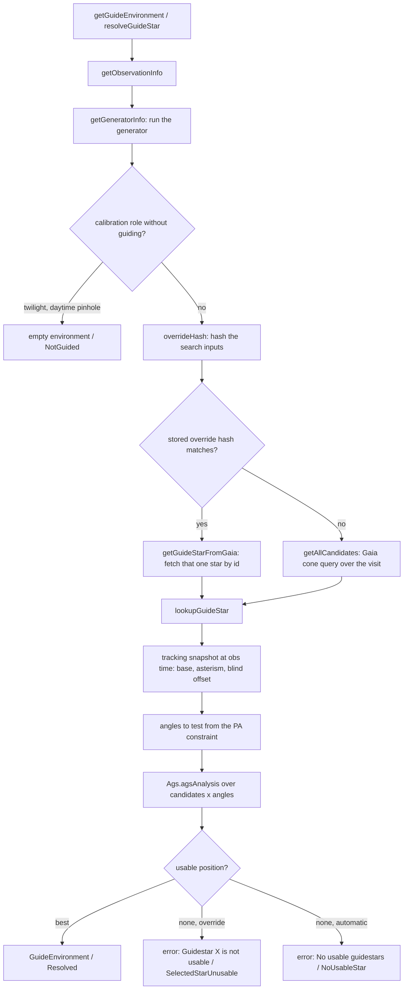
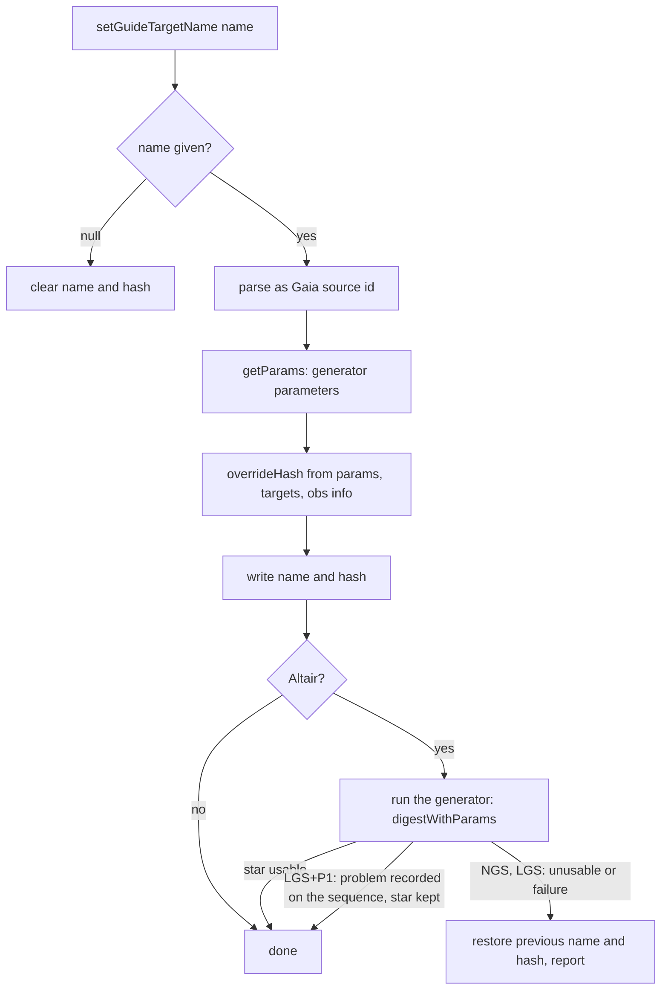
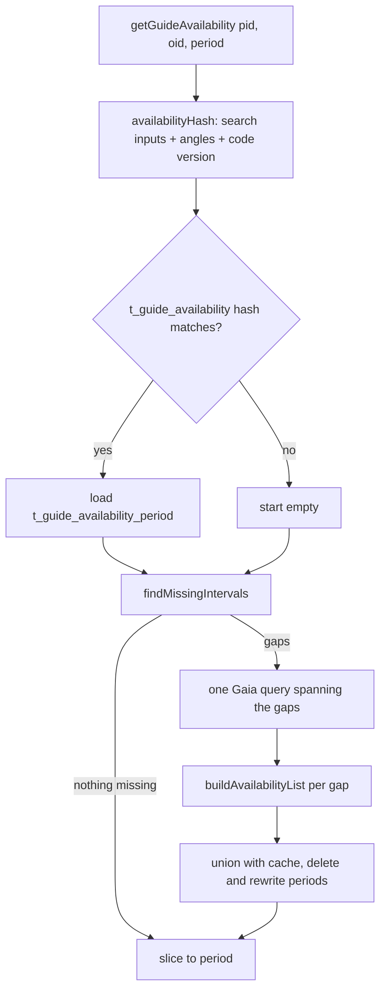
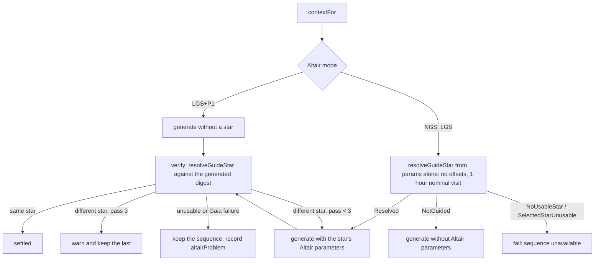

# Guide Star Flow

## Overview

The ODB picks a guide star for an observation on demand. Nothing is computed when the observation is edited: every GraphQL field that involves a guide star runs the search when it is read, and only the two cheap pieces are cached, the availability periods and the Guide Star Override (the star a user named, see `CONTEXT.md`).

Everything lives in `GuideService`. The automatic guide star search (AGS) itself is lucuma-core's `Ags.agsAnalysis`, shared with Explore; the ODB's job is to build its inputs, call Gaia for candidates, and decide between the override and the automatic pick.

## Entry Points

| GraphQL field | Service method | What it answers |
|---|---|---|
| `targetEnvironment.guideEnvironment` | `getGuideEnvironment` | The star and position angle the observation will guide with, as a `GuideEnvironment`. Errors when none is usable. |
| `targetEnvironment.guideAvailability(start, end)` | `getGuideAvailability` | Which position angles have a usable star over a period, as `GuideAvailabilityPeriod`s. |
| `targetEnvironment.guideTargetName` | `getGuideTargetName` | The override, or null once it is stale. |
| `targetEnvironment.guideProbe`, `defaultGuideProbe`, `explicitGuideProbe` | `getGuideProbes` | Which probe the search uses (see `docs/adr/0019-explicit-guide-probe.md`). |
| `altair.fieldLens`, `altair.defaultFieldLens` | `resolveGuideStar` | NGS derives the field lens from the resolved star's separation. |
| `setGuideTargetName` mutation | `setGuideTargetName` | Stores or clears the override. |

The sequence generator is the other caller: behind Altair it resolves the star itself, because the sequence depends on it (see below).

## Inputs the Search Reads

`getObservationInfo` reads one row of `t_observation`: constraints, position angle constraint, explicit base, observation time and duration, the stored override name and hash, the explicit guide probe and the Altair configuration.

`getGeneratorInfo` runs the sequence generator (`digestWithParams`) and keeps the parts the search needs: the generator parameters, setup time, full time estimate, and the acquisition and science offsets of the generated sequence. The offsets matter because AGS checks that the guide probe does not vignette the science field at every offset position.

From the generator parameters `SearchSettings` derives the site, the observing mode type, the wavelength AGS tests brightness at, and the `AgsParams` (instrument geometry plus probe) for the mode. The probe is the explicit one if set, otherwise core's `probes.defaultGuideProbe` for the mode, track type and Altair mode.

## Selecting a Guide Star

Details worth knowing:

- **Time.** The search is run at the observation time. `getGuideEnvironment` requires it to be set; `resolveGuideStar` defaults it to the next transit of the base, and the duration to the sequence's full time estimate. Science starts after the setup time, which is what the average parallactic angle is computed over.
- **Candidates.** `getGaiaQuery` asks Gaia for stars in the probe's patrol area around the base at the start and end of the visit, within brightness limits from `guideStarBrightnessConstraints` for the constraints, probe, Altair mode and wavelength. Up to 1000 are read. Proper motion is applied to the observation time before analysis.
- **Angles.** `Fixed` and `ParallacticOverride` test one angle, `AllowFlip` two, `AverageParallactic` the computed one, `Unbounded` every 10 degrees. AGS returns the best usable (candidate, angle) pair.
- **Science positions.** The asterism's coordinates, the blind offset target if any, and for GHOST the sky fiber position, all offset by the sequence's acquisition and science offsets.

## Guide Star Override

The user names a Gaia star with `setGuideTargetName`. It is stored in `t_observation.c_guide_target_name` together with `c_guide_target_hash`, a hash of the search inputs at the time (ADR 0030). The override is honoured only while that hash still matches; otherwise the automatic search runs as if nothing were stored, and `guideTargetName` reads as null.

What the hash covers, via `ObservationInfo.overrideHash` and `SearchSettings.hash`: the `AgsParams`, AGS wavelength, offsets as defined on the observing mode (not as generated), Altair settings, explicit probe, constraints, explicit base, target and blind offset positions, the position angle constraint, and observation time and duration. It leaves out the generated sequence, the ITC result and the code version, so executing steps and deploying do not drop an override. The availability cache adds the code version, since it stores results rather than a choice.

Validation of the override happens every time it is used: if the named star is no longer usable, `guideEnvironment` errors with "Guidestar X is not usable" and the generator (behind Altair) refuses to produce a sequence, instead of silently falling back to automatic selection.

For Altair the mutation runs the generator after writing, since only a generation can tell whether the star works with the sequence it shapes. The generator runs outside the transaction (it calls Gaia and the ITC), so on failure the previous name and hash are written back by hand. In LGS+P1 the generator records the problem against the sequence rather than failing, so the override is kept and the error surfaces when the sequence is asked for.

## Availability

`getGuideAvailability` answers "at which position angles is there some usable star" over a period of up to 200 days, for Explore's scheduling views. It is the expensive path, so it is cached.

Within a gap, `buildAvailabilityPeriod` runs AGS at the period start and records, per angle, the earliest date a usable candidate or a science target moves more than 100 milliarcseconds (`invalidThreshold`). That date ends the period; the next period starts there and the loop repeats until the end of the gap. Sidereal targets get a closed-form invalid date from their proper motion; nonsidereal ones are stepped day by day. The AGS stream stops early once every angle has a usable star that lasts past the cutoff.

Periods whose gaps are more than 200 days apart replace the cache instead of extending it.

## Altair

GNIRS behind Altair inverts the usual order: the ITC inputs include the guide star's separation and R brightness, so the sequence cannot be generated until the star is known, and the star cannot be verified until the sequence's offsets exist. `GeneratorContext.contextFor` handles this:

`altairProblem` is not a failure of generation: the guide star calculations need a sequence to check the star against, so `digestWithParams` (what `GuideService` calls) hands back the context as is, while `digest` and the other generator entry points report the problem. An NGS observation's default field lens follows the resolved star's separation, which is why `altair.fieldLens` resolves a star too.

## Storage

| Table / column | Holds |
|---|---|
| `t_observation.c_guide_target_name`, `c_guide_target_hash` | The override and the hash it is valid for. Both set or both null. |
| `t_observation.c_explicit_guide_probe` | The probe override. |
| `t_guide_availability` | One row per observation: the hash the cached periods were computed under. |
| `t_guide_availability_period` | Contiguous periods with the usable position angles for each. |

## Key Files

| File | Purpose |
|------|---------|
| `modules/service/.../service/GuideService.scala` | Everything above: inputs, Gaia, AGS, override, availability |
| `modules/service/.../logic/GeneratorContext.scala` | The Altair pick-generate-verify loop |
| `modules/service/.../logic/Generator.scala` | `digestWithParams` versus `digest` and `altairChecked` |
| `modules/service/.../graphql/mapping/TargetEnvironmentMapping.scala` | GraphQL field handlers |
| `modules/service/.../service/GeneratorParamsService.scala` | Mirrors the default probe rule for the generator's inputs |
