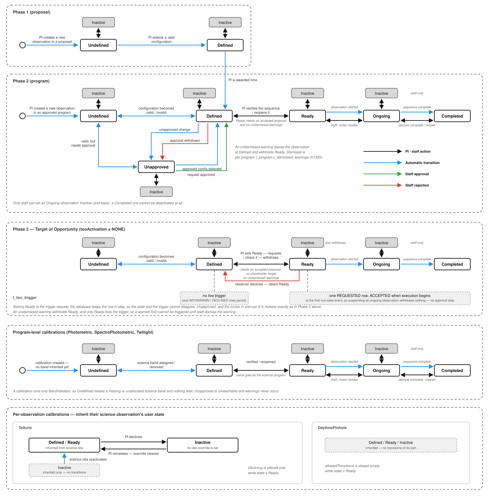

# Observation workflow states and transitions

Source of truth: `ObservationWorkflowService.workflowStateAndTransitions`
(`modules/service/src/main/scala/lucuma/odb/service/ObservationWorkflowService.scala`).

Black edges are the ones reachable through the `setObservationWorkflowState`
mutation — they are exactly the contents of `allowedTransitions`. Every other
colour is a re-derivation that happens on its own,
distinguished by who triggers it: blue for the PI editing the observation,
green for a staff approval, red for a staff denial.



The five panels are, top to bottom: science observations in a proposal, science
observations in a program, Targets of Opportunity, program-level calibrations,
and per-observation calibrations. Each is described below.

## Main lifecycle

`Inactive` returns to `executionState.getOrElse(validationStatus)` — so if
execution has already begun it comes back as `Ongoing`, otherwise to whatever the
validation state recomputes to, which need not be the state it left.

### Suspending an ongoing observation

Staff can take an `Ongoing` observation to `Suspended` and back (SC-10977), for
example to stop the scheduler from picking up a partly executed observation.
`Suspended` means started but not completed, and not to be considered for
further execution unless and until resumed; `Inactive` is left meaning an
observation set aside before execution began.

- Only staff and above can do it; a PI is offered neither edge. Per-observation
  calibrations are excluded, because they are suspended with their science
  observation.
- The suspension is not a user state. It is a flag of its own,
  `c_suspended` on `t_observation_execution` (V1404), and it overrides an
  `Ongoing` execution state, but not `Completed`. The user state is what the PI
  (or anyone, before execution) asked for, and execution overrides it as it
  always has: an observation set `Inactive` and executed anyway is `Ongoing`,
  and its `'inactive'` stays stored.
- The flag lives on `t_observation_execution` because that is the row event
  processing locks first (V1227). Telling a suspension apart from a user state
  inside one column would mean rewriting `t_observation` from event processing
  and obscalc, after `t_obscalc` is locked, which is the reverse of the order
  observation edits take and could deadlock.
- A suspension survives later events. Execution does not check the workflow,
  so if the sequence finishes while the observation is suspended, it becomes
  `Completed`. The flag stays set; should the observation stop being complete it
  is suspended again, until staff resume it.
- Going back to `Ongoing` clears the flag and nothing else. The user state was
  never touched, so a Target of Opportunity's `ready` survives the suspension.
- The observation stays locked for editing: `Suspended`, like `Ongoing`, is
  outside the states that permit pre-execution edits (`preExecutionSet`).
- Program and group time estimates, group progress (a suspended, incomplete
  element doesn't count) and program-level calibration generation leave out a
  suspended observation as they leave out an inactive one. The SQL ones read
  the workflow state obscalc stored (`suspended`), so they leave out the
  observation's per-observation calibrations too, and let it back in once it
  completes. The proposal-side readers of the user state (the observations
  considered for configuration requests, the proposal summary's instruments and
  AEON required instruments) look at the PI's user state only. Time already
  charged is unaffected.

### Defined and Unapproved

`Unapproved` is one state standing for four validation codes
(`validateConfigurations`): no request exists, all requests denied, or some
request still pending. There is no separate reviewed/unreviewed state — approval
lives entirely in `ConfigurationRequestStatus` — so each direction between
`Defined` and `Unapproved` has both a PI route and a staff route:

| Edge | Trigger |
|---|---|
| `Defined -> Unapproved` (blue) | PI changes the configuration to one no approved request covers |
| `Defined -> Unapproved` (red) | staff withdraws the approval that was holding it `Defined` |
| `Unapproved -> Defined` (blue) | PI changes the configuration to one an approved request already covers |
| `Unapproved -> Defined` (green) | staff approves the pending request |

`Defined` requires at least one request with status `Approved`. Note that denying
a request that was merely *pending* changes the validation code but not the
state — the observation stays `Unapproved` — so the red edge specifically means
revoking an approval, not the everyday act of rejecting a request.

### Warnings

A warning is a validation code whose severity is `Nonfatal` — today that is only
`GenericWarning`, emitted by `ConditionsProbabilityValidator` (conditions
likelihood below 10%) and `TotalSignalToNoiseValidator` (total S/N below 3).

Warnings leave `validationStatus` at `Defined`; what they change is the exit.
`allowedTransitions` withholds `Ready` until every warning the observation
carries has been dismissed, so a warned observation sits at `Defined` with
`Inactive` as its only way out.

Dismissal is a **program** property, not an observation one: `c_dismissed_warnings`
on `t_program` (V1305), edited through `updatePrograms` and writable by staff and
above only. Dismissing a code therefore clears it for every observation in the
program at once, and a trigger (V1306) invalidates the program's whole obscalc
cache so the transitions recompute.

Note that warnings do not skip the second validation stage: `ObservationValidator`
filters stage 2 on `hasErrors` rather than on emptiness, precisely so a dismissed
warning cannot let an observation reach `Ready` without the ITC and exposure
checks having run.

There was once a third user state, `ForReview`, sitting between `Defined` and
`Ready`. It was removed in SC-10025 (`V1299__undo_for_review.sql`), which dropped
it from `e_workflow_state` and `e_workflow_user_state` and mapped existing rows
back to `defined` and `null`.

## Targets of Opportunity

A ToO observation (i.e., an observation with a `tooActivation` other than `NONE`)
is "triggered" when its workflow state becomes `Ready`. In other words, a new
row is inserted in `t_too_trigger` to record the trigger timestamp and current
trigger state. A _database_ trigger on `t_observation` (`too_trigger_track_ready`,
V1246) watches `c_workflow_user_state` and `c_too_activation` together:

| Change | Effect                                              |
|---|-----------------------------------------------------|
| becomes `ready` while activation ≠ `NONE` | inserts a `REQUESTED` trigger in t_too_trigger      |
| leaves `ready`, or activation drops to `NONE` | marks the live trigger `WITHDRAWN` in t_too_trigger |

So `Defined -> Ready` is the request and `Ready -> Defined` is the withdrawal,
both using the ordinary `setObservationWorkflowState` mutation and its ordinary
authorization. There is no `requestTooTrigger`. Because `Defined -> Ready`
already requires an accepted proposal and forbids an opportunity asterism, a
trigger cannot be raised for an unapproved program or for an observation still
holding a placeholder target.

Warnings interact with this: an undismissed warning withholds `Ready`, and only
`Ready` fires the database trigger, so a warned ToO cannot be triggered at all
until staff dismiss the warning for its program.

Note that `Inactive` and `Ready` share one column, so marking a triggered
observation inactive **withdraws its trigger**; returning it to `Ready` requests
a new one. That is intended — inactive means "do not observe this".

The one observer-side action is `declineTooTrigger` (staff), which records a
reason and clears the observation's `Ready` state, returning it to `Defined`.
The service sets the status *before* clearing the state so the database trigger
finds no `REQUESTED` row in `t_too_trigger` to withdraw and the decision, with
its reason, is what survives in the history.

There is deliberately no per-trigger approval: the proposal's ToO activation
ceiling, frozen at acceptance (V1245), is the authorization. Nor is there a
status meaning "executing": the request is `ACCEPTED` at the first non-slew
execution event (V1275), the same instant the observation becomes `Ongoing`.
So a running observation has no live trigger to withdraw. Suspending an
ongoing ToO doesn't touch its user state at all, so its `ready` stays, nothing
is withdrawn, and resuming it requests nothing: the accepted row stays as it is.

The exception is a visitor-mode observation that staff declare `Ongoing` before
any event. That transition clears `ready` too, so it withdraws a request that
has not yet been accepted. This predates the staff `Ongoing <-> Suspended` edges.

An opportunity target is a placeholder for a target not yet found, so it is a
`ConfigurationError` (hence `Undefined`) both when the observation declares no
ToO activation and when the observation has been set `Ready` — the latter a
backstop against swapping a placeholder back in after triggering.

## Calibrations

Two rules apply to **every** calibration role, whatever its kind:

- A calibration runs exactly one validator, `BandValidator` — and nothing else.
  Its only possible error is therefore a missing or unallocated science band,
  which makes it `Undefined`; it is never `Unapproved`, and it never carries
  warnings, so nothing withholds its `Defined -> Ready` edge.
- A calibration is only ever created inside a group of the science program it
  serves — one group shared by the program's calibrations, or one group per
  science observation. It therefore carries that program's type and its
  allocations: `BandValidator` sees the science program's bands, and the
  `Defined -> Ready` gate applies exactly as it does to a science observation,
  accepted proposal included. There is no separate calibration program to
  exempt it.

Beyond that the generated roles split into two groups. `DaytimeCalibration`
observations are created by staff, so they do not appear here:

| Role | Group | Lifecycle |
|---|---|---|
| `Photometric`, `SpectroPhotometric`, `Twilight` | program-level | the generic lifecycle above, entered at `Undefined` until a band is inherited |
| `Telluric`, `DaytimePinhole`, `DaytimeFlat`, `DaytimeArc` | per-observation | inherits its parent observation's user state; see below |

### Program-level calibrations

`Photometric`, `SpectroPhotometric`, and `Twilight` fall through to the generic
`else` branch of `allowedTransitions`, so they run the full lifecycle under the
same gate conditions as the science observations they sit beside. The two edges that return
"to the validation state" (`Ready -> validationStatus` and
`Inactive -> validationStatus`) land on `Defined` or `Undefined` according to
whether the calibration holds a band at the time.

Compared with the main lifecycle, only the left-hand side changes: `Unapproved` is
unreachable and `Undefined` means the band and nothing else. Everything from
`Ready` rightwards is identical, including the staff-and-visitor-mode restriction
on `Ready <-> Ongoing`.

### Per-observation calibrations

Tellurics, daytime pinholes and daytime flats are auto-created alongside their science
observation, and a daytime arc alongside its GMOS spectrophotometric standard, in a
group of its own nested in the program's Calibrations group. None normally has
transitions of its own — each inherits the user state of the parent observation in
its group. SC-8458 carves out one exception, for tellurics only.

A telluric that is `Inactive` only because its science observation is inactive
offers no transitions — there is no override to clear. Both calibration carve-outs
apply only while `state <= Ready`; once execution begins the generic rules resume,
except that a per-observation calibration never gets the staff
`Ongoing <-> Suspended` edges. It follows its science observation instead,
including when staff suspend an ongoing science observation, whether or not
the calibration itself has started: one not yet taken is `Suspended` with its
science, and inherits the science's user state again (`Ready`, say) once it is
resumed, or once the science completes: a completed observation is no longer
suspended, and the calibration service queues a calibration it left stored as
`Suspended` for recalculation. Suspending
the science deletes none of its calibrations, because its execution state
protects them, and it keeps its calibration group even when that group is
empty. Calibration syncing (the telluric count and the daytime calibrations)
pauses while the science is suspended and resumes when it returns to `Ongoing`.
Program-level calibrations behave differently: a suspended observation stops
needing the ones not yet taken, so they are removed, and they
are generated again if it returns to `Ongoing`. A declined
telluric that is executed anyway shows as `Ongoing`: execution overrides its
override, as it overrides any user state, though the override stays stored.

## Transition conditions

| Transition | Requires |
|---|---|
| `Defined -> Ready` | no undismissed warnings, not an exchange observation, not a target of opportunity, and (proposal accepted or program has no proposal — `hasProposal` is true only for `Science`, `Keck`, `Subaru`) |
| `Ready -> Ongoing`, `Ongoing -> Ready` | visitor observing mode **and** staff access or above |
| `Ongoing -> Suspended`, `Suspended -> Ongoing` | staff access or above, and not a per-observation calibration (`Telluric`, `DaytimePinhole`, `DaytimeFlat`) |
| `Completed -> Ongoing` | execution state was explicitly declared complete, not naturally complete |
| `Telluric -> Inactive` | calibration role is `Telluric` and `state <= Ready` |
| `Telluric Inactive -> inherited` | the telluric's own `c_workflow_user_state` is `Inactive` |

Exchange observations (Keck/Subaru) run off-Gemini and have no
`Ready`/`Ongoing`/`Completed` lifecycle at all; `Inactive` is their only
transition out of `Defined`.

## DB Columns

The state is not stored as a single column. It is computed each time, from three
independent sources, in this precedence order:

| Kind | Members | Where it comes from |
|---|---|---|
| `ExecutionState` | `Ongoing`, `Completed` | `c_declared_execution_state`, else the generator's execution state |
| `UserState` | `Inactive`, `Ready` | `c_workflow_user_state` — for a ToO observation, `Ready` also maintains a row in `t_too_trigger` |
| suspension | `Suspended` | `t_observation_execution.c_suspended`, set by staff on an executing observation |
| `ValidationState` | `Undefined`, `Unapproved`, `Defined` | validation codes computed from the observation |

Execution wins over user state, which wins over validation — except that a
validation error suppresses a stored `Ready` (but never a stored `Inactive`).
A suspension wins over an `Ongoing` execution state, but never over
`Completed`. A per-observation calibration takes its science observation's
suspension, as it takes its user state.

## Stored transitions

Obscalc stores the workflow in `t_obscalc` (`c_workflow_state`,
`c_workflow_transitions`, `c_workflow_validations`) and computes it as the
service user, so the stored transitions are the ones staff could take. When a
user below staff reads `validTransitions`,
`ObservationWorkflowService.visibleTransitions` removes the staff-only edges
listed in `StaffOnlyTransitions`: `Ready <-> Ongoing` (visitor modes) and
`Ongoing <-> Suspended`.

The `setObservationWorkflowState` mutation does not read the stored value. It
checks the workflow computed live for the caller, and that computation applies
the same filter: `workflowStateAndTransitions` works out what staff could do,
from conditions on the observation alone, and passes the result through
`visibleTransitions`. `StaffOnlyTransitions` is therefore the one place that
says which transitions need staff, for the mutation and for every read alike.
A new staff-only transition is a new pair there.

A list of state pairs cannot make one transition staff-only for some
observations and open to everyone for others. Nothing needs that today. If
something does, obscalc would have to store a second, non-staff transition list.

## Regenerating the diagram

There is nothing to regenerate: `observation-workflow.svg` is hand-authored and
is its own source. It is deliberately not produced from mermaid or any other
text format — the readability depends on hand-placed nodes (`Inactive` stacked
above each state, `Unapproved` dropped below the row, the legend parked in the
gap), and auto-layout engines will not reproduce that.

To change it, edit the SVG directly. The header comment lists the shared column
positions and the per-panel `y` bands; keeping equivalent states on the same
column is what makes the panels comparable at a glance.

To preview a change on macOS:

```bash
qlmanage -t -s 1520 -o /tmp docs/observation-workflow.svg   # writes /tmp/observation-workflow.svg.png
```

`qlmanage` crops to a square rather than fitting, so part of the diagram is cut
off either way. To see the whole thing, temporarily pad the `viewBox`/`width` to
a square (`0 0 1540 1540`) in a scratch copy, or just open the file in a browser,
which honours the real aspect ratio.

When adding a panel, extend the root `viewBox`, `height` and the background
`<rect>` to match. Appending at the bottom leaves every existing coordinate
alone. Inserting one in the middle — as the Target of Opportunity panel was,
to keep it next to the Phase 2 panel it varies — means shifting every panel
below it. That is mechanical, because the calibration panels use only
`y`/`y1`/`y2`/`cy` attributes and no `path` data:

```bash
perl -pi -e 'if ($. >= 182 && $. <= 262) { s/\b(y|y1|y2|cy)="(\d+)"/$1 . "=\"" . ($2+320) . "\""/ge }' observation-workflow.svg
```

Check the line range and the offset first, and re-render afterwards — a panel
that uses `path d="…"` coordinates would need those edited by hand as well.
